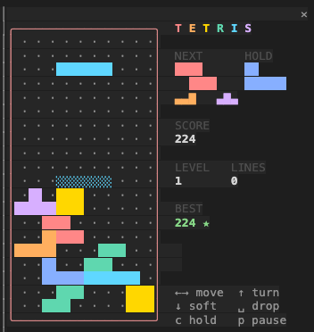

# Tetris for Claude Code

Play Tetris in a side pane while Claude works. Type `/tetris`, click the board, play.



A [Claude Code mod](https://code.claude.com/docs/en/plugins/mods/create): the game runs inside Claude Code itself, in the desktop app's Code tab and in the terminal. No extra model calls, no network, nothing to run on the side.

## Install

At the prompt of a terminal session:

```
/plugin install tetris --marketplace haider0072/claude-tetris
```

Answer `y` to add the marketplace, then pick the **user** scope so it is on in every session. Or from a shell:

```bash
claude plugin install tetris --marketplace haider0072/claude-tetris
```

A plugin installed at the user scope also loads in the desktop app's Code tab.

Needs a Claude Code with mods (function hooks); built and tested on 2.1.293.

## Play

| Key | Does |
| --- | --- |
| `←` `→` (or `a` `d`, `h` `l`) | move |
| `↑` `x` (or `w`, `k`) | rotate clockwise |
| `z` | rotate counter-clockwise |
| `↓` (or `s`, `j`) | soft drop |
| `Space` | hard drop |
| `c` | hold |
| `p` | pause (any key resumes) |
| `r` | restart (when paused or over) |

Keys reach the board once you **click it**; `Esc` hands them back to the prompt.

- **Plays while Claude works.** `/tetris` runs at once, even mid-turn.
- **Pauses itself** the moment you type at the prompt (moving the cursor does not count), or after 20 seconds with no key.
- **Picks up where you left off.** Close the pane, switch sessions, restart Claude Code: the game comes back paused. Your best score is kept too.
- **Modern rules.** 7-bag randomizer, SRS rotation with wall kicks, hold, ghost piece, lock delay, combos, back-to-back Tetris, levels that speed up every 10 lines.
- **Grows with the pane.** The biggest board the pane has room for, blocks up to three times the size with a beveled edge; the score beside the well in a wide pane, above it in a tall one; a compact half-block layout when the pane is small. Colors follow your theme.

In the terminal, the pane docks as a sidebar in the fullscreen layout, where mouse clicks reach it. On the main screen (tmux, `CLAUDE_CODE_NO_FLICKER=0`) the pane opens above the prompt but the board cannot be clicked, so play it in fullscreen or in the desktop app.

## How it works

| File | Role |
| --- | --- |
| `hooks/register.tsx` | The hooks module: registers `/tetris`, opens the pane, keeps progress in the plugin store, pauses the board when you type at the prompt |
| `hooks/client.tsx` | The board's surface module: runs the game loop on the drawing thread and reads keys |
| `hooks/game.ts` | The rules, as pure functions over a plain-JSON game |
| `hooks/save.ts` | Checks a saved game field by field before it is resumed |
| `hooks/view.tsx` | Picks the biggest layout the pane has room for and puts the pieces together |
| `hooks/board.ts` | The well as styled lines at any block size, with the start, pause and game-over words over it |
| `hooks/panels.tsx` | Score, previews and keys: beside the well, above it, or compact |
| `hooks/spans.ts` | Styled runs of text, the unit every drawn line is built from |
| `hooks/palette.ts` | Piece colors and the theme keys for everything else |
| `hooks/protocol.ts` | What the hooks module and the board send each other |

## Develop

```bash
git clone https://github.com/haider0072/claude-tetris.git
claude --plugin-dir ./claude-tetris
```

Saving a file reloads the mod in that session. Check it with:

```bash
claude plugin validate ./claude-tetris
claude plugin test ./claude-tetris
```

Claude Code lays the API's type declarations in `.claude-plugin/types/` when it loads the mod; after that `tsc -p ./claude-tetris` type-checks it.

## License

MIT
